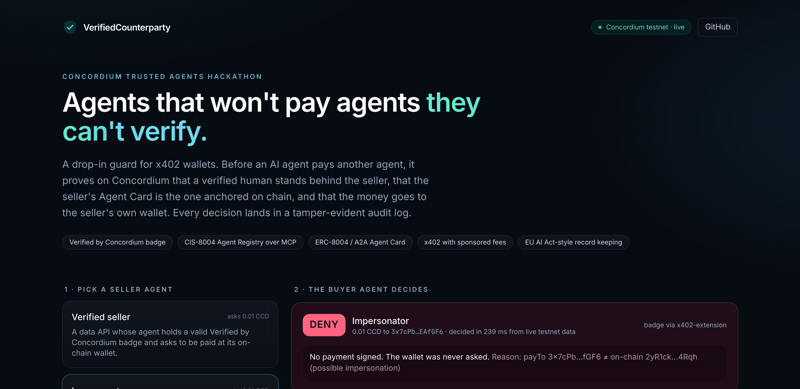
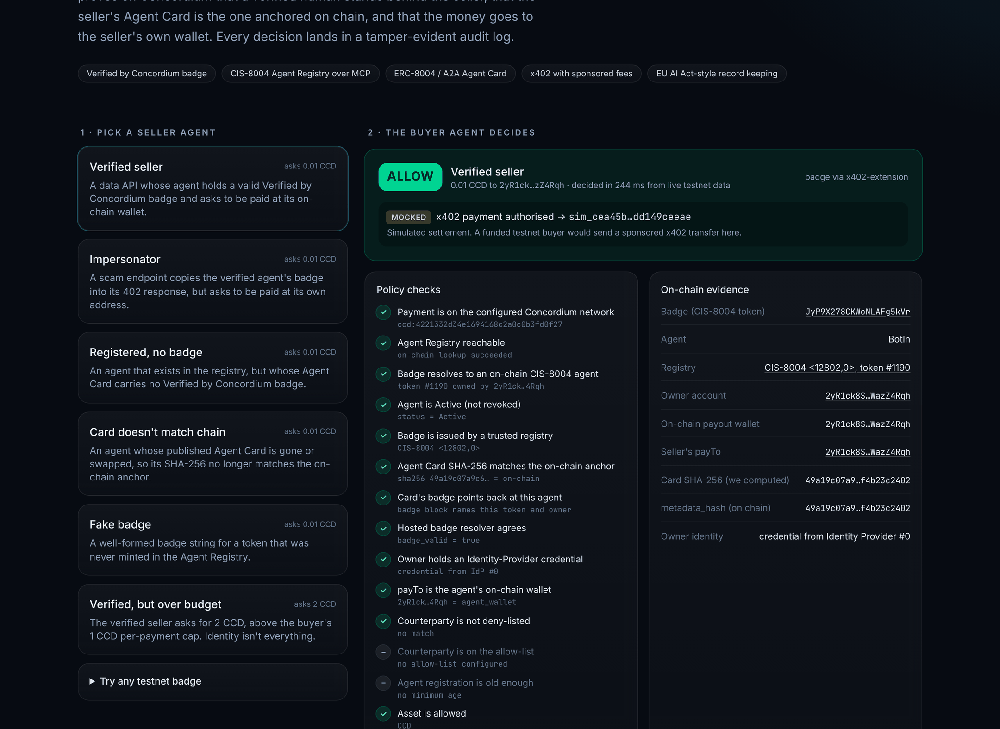
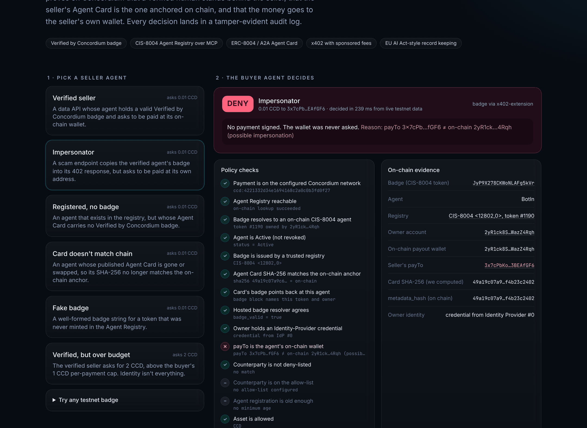
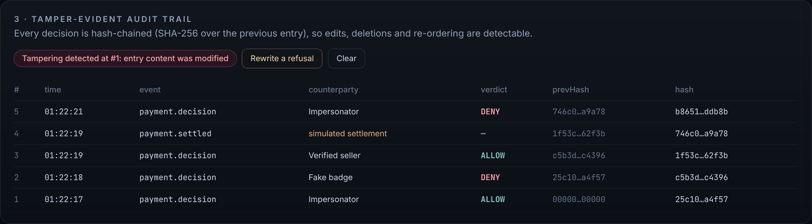
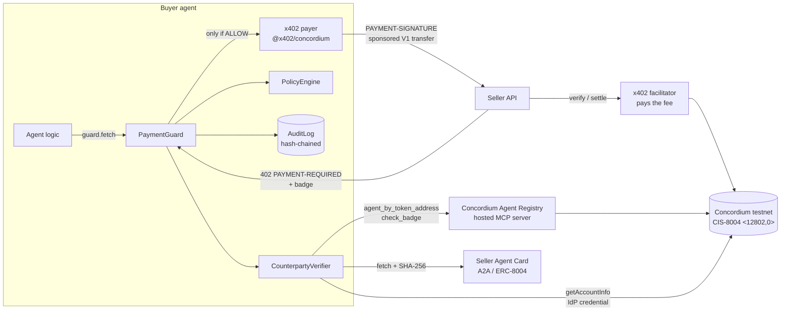
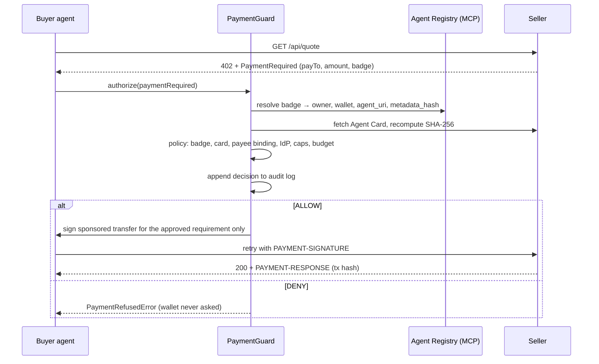

<div align="center">

# VerifiedCounterparty

**An x402 payment guard for AI agents: never pay an agent that can't prove a verified human stands behind it.**

[](https://github.com/onepolymath/verified-counterparty/actions/workflows/ci.yml)


[](LICENSE)

[**Live demo**](https://verified-counterparty.vercel.app) · [Threat model](docs/THREAT_MODEL.md) · [Go-live plan](docs/GO_LIVE.md) · [Demo script](docs/DEMO_SCRIPT.md)

Built for the [Concordium Trusted Agents Hackathon](https://www.concordium.com/article/concordium-trusted-agents-hackathon-encode-club) (Encode Club, Nov–Dec 2026).



</div>

---

## The problem

Agents now pay other agents for data, APIs and work, usually over [x402](https://docs.x402.org): the seller answers `402 Payment Required`, the buyer's wallet signs, done. Nothing in that loop asks **who is on the other side**. That opens a new scam channel:

- **Impersonation.** A scam endpoint copies a reputable agent's badge or Agent Card into its 402 and asks to be paid at _its own_ address.
- **Card swapping.** A seller's published profile is changed after it was vouched for.
- **Fake or anonymous sellers.** Badge strings that were never minted, or agents with no accountable owner.
- **Runaway spend.** A legitimate seller asks for more than the agent's owner ever intended.

## The solution

VerifiedCounterparty sits between an agent and its x402 wallet. Before any payment is signed, it:

1. **Resolves the seller's Verified by Concordium badge on chain** (CIS-8004 Agent Registry, via Concordium's hosted MCP server) and decodes the badge locally to check it comes from a registry we trust.
2. **Fetches the seller's Agent Card itself and recomputes its SHA-256**, comparing it with the `metadata_hash` anchored on chain, and checks that the card's badge block points back at the same token and owner.
3. **Binds the payment to the agent**: x402 `payTo` must equal the agent's on-chain payment wallet. This is what defeats impersonators who reuse an honest badge.
4. **Checks a verified human is accountable**: reads the owner account's credential from the chain and confirms it was issued by a Concordium **Identity Provider** (no personal data is revealed).
5. **Applies the owner's policy**: allowed assets, per-payment cap, rolling 24h budget, deny/allow-lists, minimum agent age.
6. **Writes every decision to a hash-chained audit log** (who, what, why, which evidence), designed for EU AI Act-style record keeping, then lets the wallet sign exactly the approved requirement. Refusals never reach the wallet.

Sellers get the mirror image: a `SellerGate` that only serves buyer agents whose owners are ID-verified.

| Verified seller → **ALLOW**                  | Impersonator → **DENY**                                  |
| -------------------------------------------- | -------------------------------------------------------- |
|  |  |



## Architecture





### Modules (`packages/core`)

| Module                                    | Responsibility                                                                                                                                                                                                              |
| ----------------------------------------- | --------------------------------------------------------------------------------------------------------------------------------------------------------------------------------------------------------------------------- |
| [`registry/`](packages/core/src/registry) | Dependency-free MCP client (JSON + SSE), badge parsing (short and CAIP-19), local Base58Check decoding, Agent Card badge extraction (A2A extension and legacy forms).                                                       |
| [`verifier/`](packages/core/src/verifier) | Collects **evidence** only: on-chain record, our own card hash, self-reference, payee binding, Identity Provider credential, resolver second opinion. Never throws on remote failure; records it so policy can fail closed. |
| [`policy/`](packages/core/src/policy)     | Zod-typed policy with strict defaults and a pure, deterministic engine. All 16 rules always run, so the audit log shows the full picture. Rolling spend ledger in `bigint` atomic units.                                    |
| [`payment/`](packages/core/src/payment)   | `PaymentGuard` (discovery → verify → decide → audit → pay), a real `ConcordiumX402Payer` (sponsored V1 transfers), an `x402Client` hook, and a clearly-labelled `SimulatedPayer`.                                           |
| [`audit/`](packages/core/src/audit)       | Append-only SHA-256 hash chain with serialised appends (no forks under concurrency) and `verifyChain`; memory, JSONL and browser sinks.                                                                                     |
| [`seller/`](packages/core/src/seller)     | `SellerGate`: serve only agents backed by ID-verified owners.                                                                                                                                                               |

`apps/web` is the Next.js demo; `/api/evaluate` runs the same guard against live testnet.

## Quickstart

```bash
corepack enable && pnpm install
pnpm --filter @verified-counterparty/core build

pnpm demo        # every scenario against LIVE Concordium testnet, prints verdicts + audit status
pnpm test        # 134 unit + HTTP integration tests, offline
pnpm test:live   # live testnet assertions
pnpm dev         # demo UI at http://localhost:3000
```

Use it in an agent:

```ts
import { createGuard, PaymentRefusedError } from "@verified-counterparty/core";
import { ConcordiumX402Payer } from "@verified-counterparty/core/x402";

const { guard } = createGuard({
  payer: new ConcordiumX402Payer({
    network: "testnet",
    account: process.env.VC_BUYER_ACCOUNT!,
    privateKeyHex: process.env.VC_BUYER_KEY!,
  }),
  config: { policy: { maxAmountPerPayment: { CCD: "100000" }, minRegistrationAgeHours: 24 } },
});

try {
  const { response, settlement } = await guard.fetch(
    "https://seller.example/api/quote",
    {},
    { purpose: "price check" },
  );
} catch (e) {
  if (e instanceof PaymentRefusedError) console.warn(e.authorization.decision.summary); // e.g. "DENY: payee.bound"
}
```

Already using `x402Client` directly? `client.onBeforePaymentCreation(guardHook(guard))`.

Real testnet payment from the CLI (needs a funded testnet account, see [docs/TESTNET_SETUP.md](docs/TESTNET_SETUP.md)):

```bash
VC_BUYER_ACCOUNT=… VC_BUYER_KEY=… pnpm pay https://seller.example/api/quote
```

## Real vs mocked

| Part                                                                                        | Status                                                                                                                                                                                                                                                                                  |
| ------------------------------------------------------------------------------------------- | --------------------------------------------------------------------------------------------------------------------------------------------------------------------------------------------------------------------------------------------------------------------------------------- |
| Badge resolution (CIS-8004 `<12802,0>` on testnet) via the hosted Agent Registry MCP server | ✅ **Real**, live on every request                                                                                                                                                                                                                                                      |
| Agent Card fetch + SHA-256 vs on-chain `metadata_hash`                                      | ✅ **Real**, computed by us                                                                                                                                                                                                                                                             |
| Owner's Identity Provider credential (gRPC `getAccountInfo`)                                | ✅ **Real** read on the hosted demo (shows "IdP #0"); skipped with a label if the node is unreachable. Note: on **testnet**, identity providers issue identities _without_ document checks, so this proves the mechanism; on mainnet the same credential means a real ID check happened |
| Policy engine, payee binding, budgets, audit hash chain                                     | ✅ **Real**, production code                                                                                                                                                                                                                                                            |
| Demo counterparties                                                                         | ✅ **Real** third-party testnet agents (labels describe their badge state, not their operators). The impersonator's payout address is derived from a hash and has no known key                                                                                                          |
| x402 payment signing (`ConcordiumX402Payer`, `pnpm pay`)                                    | ✅ Real code using `@x402/concordium`; needs a funded testnet buyer account                                                                                                                                                                                                             |
| **Settlement in the hosted demo**                                                           | 🟡 **MOCKED**: no funds move; the UI shows a `sim_…` id labelled MOCKED                                                                                                                                                                                                                 |
| **Sellers' 402 responses in the demo**                                                      | 🟡 **MOCKED**: generated from each scenario (the badges inside them are real)                                                                                                                                                                                                           |
| Demo audit log storage                                                                      | 🟡 Browser localStorage (the CLI uses an append-only JSONL file)                                                                                                                                                                                                                        |

## Threat model (summary)

| Attack                                       | Defence                                                       | Rule                         |
| -------------------------------------------- | ------------------------------------------------------------- | ---------------------------- |
| Scam endpoint reuses an honest agent's badge | `payTo` must equal the on-chain agent wallet                  | `payee.bound`                |
| Card swapped after anchoring                 | Re-fetch + SHA-256 vs `metadata_hash`                         | `card.integrity`             |
| Card borrows another agent's badge           | Badge block must name this token and owner                    | `card.self_reference`        |
| Fake / never-minted badge                    | On-chain lookup                                               | `badge.resolves`             |
| Rogue CIS-8004 deployment                    | Badge decoded locally; registry allow-list                    | `registry.trusted`           |
| Revoked agent                                | Status must be `Active`                                       | `badge.active`               |
| Anonymous owner                              | Identity Provider credential on chain                         | `identity.credential`        |
| Fresh sybil agents                           | Minimum registration age                                      | `registration.age`           |
| Over-charging / drain                        | Per-payment cap + rolling 24h budget, reserved before signing | `amount.cap`, `budget.daily` |
| Registry outage used to slip through         | Fail closed                                                   | `registry.reachable`         |
| Hiding a bad decision                        | Hash-chained audit log, `verifyChain`                         | —                            |

Full model, assumptions and residual risks: [docs/THREAT_MODEL.md](docs/THREAT_MODEL.md).

## Concordium components used

- **Verified by Concordium badge** + **Agent Registry (CIS-8004)**: resolved for every payment.
- **Hosted MCP server** (`agent-registry-mcp.concordium.com/mcp`): `agent_by_token_address`, `check_badge`.
- **ERC-8004 / A2A Agent Card**: integrity-checked and parsed for the badge extension.
- **Concordium ID layer**: Identity Provider credential on the owner account.
- **x402 with sponsored fees** (`@x402/concordium` exact scheme): the buyer never needs CCD for gas.

CCDExplorer: [Agent Registry contract <12802,0>](https://ccdexplorer.io/testnet/instance/12802/0) · [verified demo seller's owner account](https://ccdexplorer.io/testnet/account/2yR1ck8SshaDaK1QbjkRbafjoRtzSVJ1LSSyn23AdkWazZ4Rqh)

## Roadmap

- [x] Core guard, verifier, policy engine, audit log, seller gate (checkpoint 1)
- [x] Live testnet demo on Vercel
- [ ] Register our own buyer and seller agents in the testnet Agent Registry with badges (owner ID-verified)
- [ ] Real end-to-end x402 payment on testnet through the sponsoring facilitator, CCDExplorer tx link in the demo
- [ ] Expose the guard as an MCP tool (`verify_counterparty`, `pay_if_verified`) and an A2A extension
- [ ] Zero-knowledge attribute policies (e.g. "owner is 18+ / in the EU") via Concordium verifiable presentations
- [ ] Policy packs + hosted audit export (see [go-live plan](docs/GO_LIVE.md))

## Project layout

```
packages/core   policy engine · verifier · payment guard · audit log · seller gate · CLI
apps/web        Next.js 16 demo (deployed on Vercel)
docs/           threat model · go-live plan · demo script · checkpoint notes · testnet setup
```

## License

[MIT](LICENSE) © 2026 Yusuf Ojo Raifu
